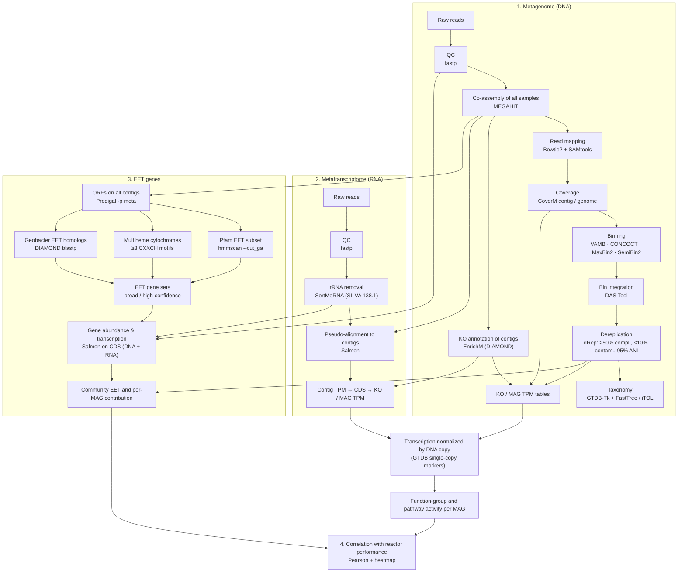

# Bioelectrochemical_Denitrification

Metagenomic and metatranscriptomic analysis pipeline for bioelectrochemical
denitrification (BED) biofilms, used in:

> Kwon, H., Wang, Q., Riveros, A., Li, Y., & Jiang, D. (2026). Abundance–transcription
> decoupling reveals functional partitioning in bioelectrochemical denitrification biofilms.
> *Environmental Research*, 308, 125626. https://doi.org/10.1016/j.envres.2026.125626

**If you use this pipeline or any part of it, please cite the paper above** (see [Citation](#citation)).

Working-electrode biofilms were sequenced (Illumina shotgun metagenomes and
metatranscriptomes, Zymo Research). The pipeline builds MAGs from a co-assembly, quantifies
genes and transcripts at contig, KO and MAG level, normalizes transcription by gene copy
number, and screens the community for extracellular electron transfer (EET) genes.
Step-by-step details are in **[PIPELINE.md](PIPELINE.md)**.

## Data

Raw reads: NCBI BioProject **[PRJNA1398933](https://www.ncbi.nlm.nih.gov/bioproject/PRJNA1398933)**

| Sample | DNA (metagenome) | RNA (metatranscriptome) |
|---|---|---|
| Cultivated biofilm (initial condition) | `zr15207_9` | `zr15207_2T` |
| Condition 1 | `zr15207_10` | `zr15207_3T` |
| Condition 2 | `zr15207_11` | `zr15207_4T` |
| Condition 3 | `zr15207_13` | `zr15207_6T` |
| Condition 4 | `zr15207_14` | `zr15207_7T` |

Operating conditions 1-4 are described in the paper's table of experimental conditions.
Sample names are hard-coded in several scripts; change them for your own data.

## Pipeline overview



## Repository layout

```
1_metagenomic/
  1_qc/                 fastp, FastQC/MultiQC
  2_assemble/           combine reads, MEGAHIT co-assembly
  3_mapping/            Bowtie2 mapping, sorted/indexed BAMs
  4_coverage/           CoverM contig (TPM, mean) and genome (TPM, relative abundance, mean)
  5_binning/            VAMB, CONCOCT, MaxBin2, SemiBin2 (bins >= 200 kb kept)
  6_bincheck/           contig-to-bin tables, DAS Tool, dRep
  7_interpretation/     GTDB-Tk + tree, EnrichM KO annotation, KO/MAG TPM,
                        top MAGs per KO, DNA-copy normalization, function/pathway activity
2_metatranscriptomic/   fastp, SortMeRNA, Salmon, KO/MAG TPM, top MAGs per KO
3_Geobacter_EET/        Geobacter reference DB, EET screening of Geobacter MAGs,
                        community-wide EET genes and per-MAG contributions
4_correlation/          Pearson correlation and heatmap (reads data.csv)
```

## Software

Versions used in the paper.

| Tool | Version | Step |
|---|---|---|
| fastp | 1.0.1 | read QC (DNA and RNA) |
| MEGAHIT | 1.2.9 | co-assembly |
| Bowtie2 | 2.5.1 | read mapping |
| SAMtools | 1.18 | BAM processing |
| CoverM | 0.7.0 | contig and genome coverage |
| VAMB | 5.0.3 | binning |
| CONCOCT | 1.1.0 | binning |
| MaxBin2 | 2.2.7 | binning |
| SemiBin2 | 2.2.0 | binning |
| DAS Tool | 1.1.7 (DIAMOND 0.9.36) | bin integration |
| dRep | 3.2.2 | dereplication |
| GTDB-Tk | 2.4.1 | taxonomy |
| FastTree | 2.1.10 | MAG tree |
| EnrichM | 0.6.5 | KO annotation |
| SortMeRNA | 4.3.4 (SILVA 138.1) | rRNA removal |
| Salmon | 1.10.3 | transcript / gene quantification |
| Prodigal | 2.6.3 | gene prediction |
| HMMER | 3.4 | Pfam domain search |
| DIAMOND | — | Geobacter homolog search |
| Python 3 | pandas, numpy, scipy, matplotlib | downstream tables and figures |

Reference data: KEGG `ko_list`, `ko_to_pathway`, `pathway_list` text files; Pfam-A HMMs;
SILVA 138.1 LSU/SSU NR99; GTDB reference data for GTDB-Tk; Geobacter proteomes from NCBI
(downloaded by `3_Geobacter_EET/1_blastdb/geobacter_db.sh`).

## How to run

1. **Install the tools** above (conda, modules or containers). Each script lists what it
   needs in a `# Requires:` line at the top.
2. **Edit the paths.** All paths are placeholders:
   - `/path/to/base/...`: your project folder (outputs are written in the same folder layout as this repository)
   - `/path/to/base/your_metagenome_raw_reads`, `/path/to/base/your_metatranscriptome_raw_reads`: raw `*_R1.fastq.gz` / `*_R2.fastq.gz`
   - `/path/to/your_db/...`: KEGG, Pfam and SILVA files
3. **Edit sample names** (`zr15207_*`) where they are listed in a script.
4. **Run the scripts in the order of [PIPELINE.md](PIPELINE.md)**, for example
   `bash 1_metagenomic/1_qc/1_fastp.sh`, or submit them to your cluster's scheduler.
   Scripts are numbered within each folder.
5. For `4_correlation/`, create `data.csv` (one row per sample/condition, one column per
   variable; `data_template.csv` shows the columns used in the paper). Column prefixes:
   `CA` community-wide abundance (DNA), `CE` community-wide expression (RNA),
   `DA` dominant taxa abundance (DNA), `DE` dominant taxa expression (RNA).

## Citation

If you use this pipeline, please cite:

Kwon, H., Wang, Q., Riveros, A., Li, Y., & Jiang, D. (2026). Abundance–transcription decoupling
reveals functional partitioning in bioelectrochemical denitrification biofilms.
*Environmental Research*, 308, 125626. https://doi.org/10.1016/j.envres.2026.125626

```bibtex
@article{kwon2026bed,
  title   = {Abundance--transcription decoupling reveals functional partitioning in bioelectrochemical denitrification biofilms},
  author  = {Kwon, Hyejeong and Wang, Qingshi and Riveros, Adriana and Li, Yanli and Jiang, Daqian},
  journal = {Environmental Research},
  volume  = {308},
  pages   = {125626},
  year    = {2026},
  doi     = {10.1016/j.envres.2026.125626}
}
```

Please also cite the individual tools listed under [Software](#software).
